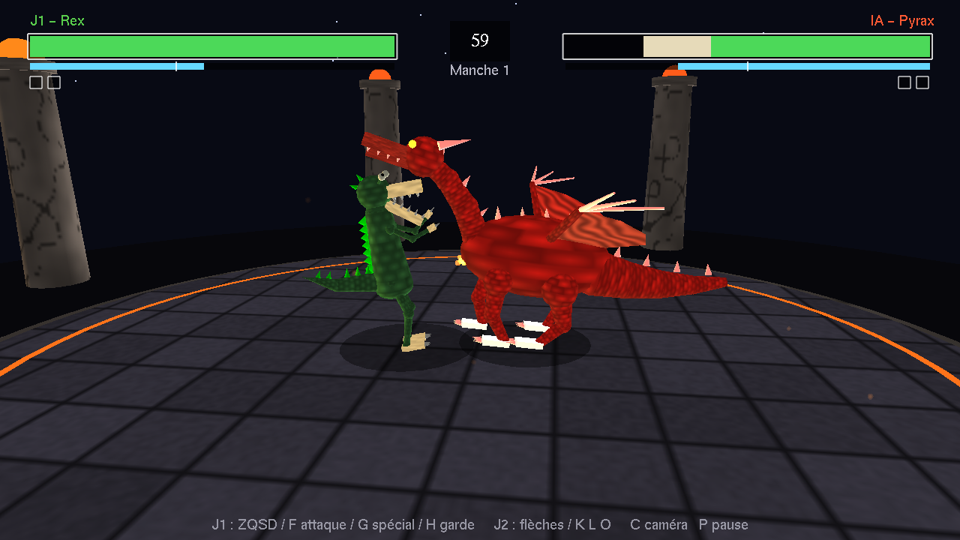

# Arène des Titans

Jeu de combat 3D en arène, écrit en C++17 avec OpenGL et freeglut. Les cinq combattants sont modélisés à la main.

## Jouer dans le navigateur

Cliquez sur le bouton pour créer un Codespace. Il installe les dépendances, compile le jeu et l’exécute dans un bureau Linux distant. Le port du jeu s’ouvre dans le navigateur via noVNC : aucune installation locale ni récupération manuelle des ressources n’est nécessaire. Si l’onglet du jeu ne s’ouvre pas automatiquement, ouvrez le port **6080** dans l’onglet **Ports** du Codespace.

> GitHub Codespaces demande une connexion GitHub et peut être soumis à des limites d’utilisation ou à une facturation. Gardez le port 6080 privé : il donne accès à la session graphique du jeu.

## Fonctionnalités
- 5 combattants jouables : Rex, R-7, Arachna, Pyrax et Granit.
- Combat solo contre une IA à trois niveaux ou deux joueurs sur le même clavier.
- Attaques, coups spéciaux, garde, projectiles, effets et caméra dynamique.
- Écran de sélection 3D, HUD, particules et textures procédurales.

## Compilation locale
Prérequis : compilateur C++17, CMake, OpenGL, GLU et freeglut.
Sur Debian ou Ubuntu : `sudo apt install build-essential cmake freeglut3-dev libglu1-mesa-dev`.

Configure et compile avec `cmake -S . -B build` puis `cmake --build build -j`.
Lance le jeu avec `./build/arene-des-titans`.

## Tests
`cd build && ctest --output-on-failure`

## Commandes
Joueur 1 : ZQSD pour se déplacer, F attaque, G spécial, H garde.
Joueur 2 : flèches, K attaque, L spécial, O garde.
C change l’angle de caméra ; P ou Échap met en pause.

## Licence
MIT, voir [LICENSE](LICENSE).
